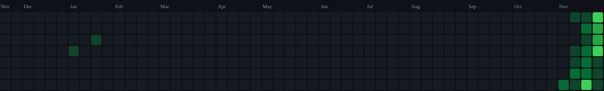

<div align="center">


<a href="https://github.com/FeizenF">
  
</a>

<br />

<a href="https://github.com/FeizenF">
  
</a>
<a href="mailto:Fernandabrian46@gmail.com">
  
</a>

<a href="https://github.com/FeizenF/FeizenF/actions/workflows/activity.yml">
  
</a>

</div>

<br />

## `01` // ABOUT

I'm an Informatics student working across **Cyber Security, Digital Forensics, and Software Development**.

Most of my work starts from the same question: how does this system actually work? I build the application to find out, then look at it from the other side — the data model, the storage, and what an attacker or an investigator would see.

```console
$ whoami
feizen · informatics student

$ pwd
informatics · cyber security · app development

$ cat focus.txt
security  forensics  web  mobile

$ status
online · open to collaboration

$ date -u
2026-11-24 · last sync 00:57 UTC
```

## `02` // FOCUS

`CYBER SECURITY` · `DIGITAL FORENSICS` · `WEB DEVELOPMENT` · `MOBILE DEVELOPMENT`

## `03` // STACK

**Languages**

<p align="left">
  
</p>

**Frameworks & Databases**

<p align="left">
  
</p>

**Tools & Environment**

<p align="left">
  
</p>

## `04` // FEATURED PROJECTS

<table>
<tr>
<td width="33%" valign="top">

### [fintrack](https://github.com/FeizenF/fintrack)

Offline personal finance manager for Android.

Multi-account ledger, budgets, savings goals, reports with charts, encrypted JSON backup.

`Flutter` `Dart` `Drift` `SQLite` `Riverpod`

</td>
<td width="33%" valign="top">

### [Student-App](https://github.com/FeizenF/Student-App)

Academic app for courses, grades, and GPA tracking.

Course and grade CRUD, automatic letter grades, live GPA calculation, local persistence.

`Flutter` `Dart` `Material 3`

</td>
<td width="33%" valign="top">

### [feizen-haven-hotel](https://github.com/FeizenF/feizen-haven-hotel)

Hotel booking system with room management and payments.

Public site, user dashboard, and admin panel behind Flask blueprints and SQL sessions.

`Flask` `Python` `MySQL` `Tailwind CSS`

</td>
</tr>
</table>

## `05` // GITHUB STATS

<p align="center">
  
</p>

<p align="center">
  
  
</p>

<p align="center">
  
  
</p>

<p align="center">
  
</p>

## `06` // PLAYGROUND

<p align="center">
  <picture>
    <source media="(prefers-color-scheme: dark)" srcset="https://raw.githubusercontent.com/FeizenF/FeizenF/output/pacman-contribution-graph-dark.svg" />
    <source media="(prefers-color-scheme: light)" srcset="https://raw.githubusercontent.com/FeizenF/FeizenF/output/pacman-contribution-graph.svg" />
    
  </picture>
</p>

<p align="center">
  <picture>
    <source media="(prefers-color-scheme: dark)" srcset="https://raw.githubusercontent.com/FeizenF/FeizenF/output/tetris-contribution-graph-dark.svg" />
    <source media="(prefers-color-scheme: light)" srcset="https://raw.githubusercontent.com/FeizenF/FeizenF/output/tetris-contribution-graph.svg" />
    
  </picture>
</p>

<p align="center">
  <picture>
    <source media="(prefers-color-scheme: dark)" srcset="https://raw.githubusercontent.com/FeizenF/FeizenF/output/github-contribution-grid-snake-dark.svg" />
    <source media="(prefers-color-scheme: light)" srcset="https://raw.githubusercontent.com/FeizenF/FeizenF/output/github-contribution-grid-snake.svg" />
    
  </picture>
</p>

<details>
<summary><b>Easter eggs</b></summary>

<br />

- I learn a system best by breaking the one I just built.
- Favourite debugging tool: reading the schema before touching the code.
- Clean data model first, interface second — the reverse always costs a rewrite.
- Open to a conversation about forensics, Linux, or a good chess game.

</details>

> *Code is the work. Everything else is just life happening in the background.*

## `07` // CONTACT

<p align="center">
  <a href="https://github.com/FeizenF">
    
  </a>
  <a href="mailto:Fernandabrian46@gmail.com">
    
  </a>
  <a href="[ISI_LINK_LINKEDIN]">
    
  </a>
  <a href="[ISI_LINK_PORTFOLIO]">
    
  </a>
</p>

<br />

---

<div align="center">


<sub>Build things. Understand systems. Keep learning.</sub>

</div>
